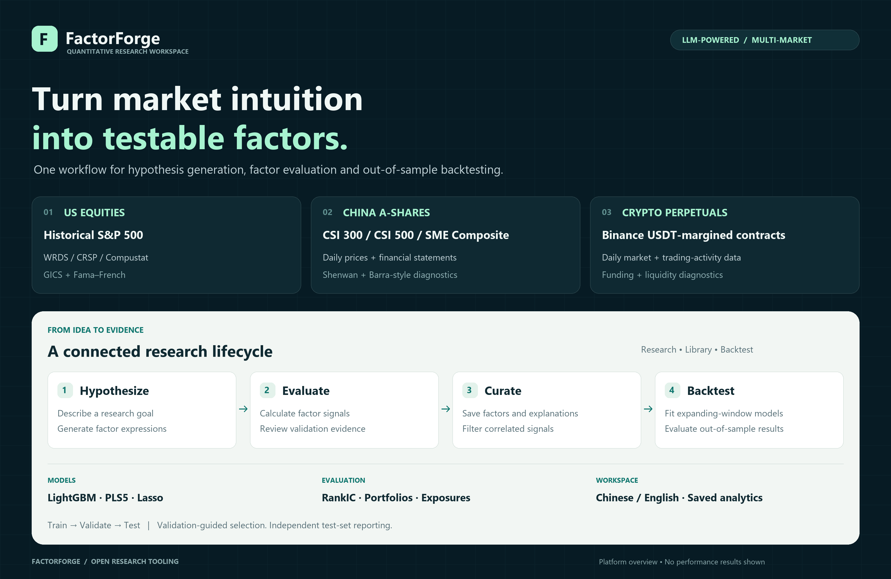
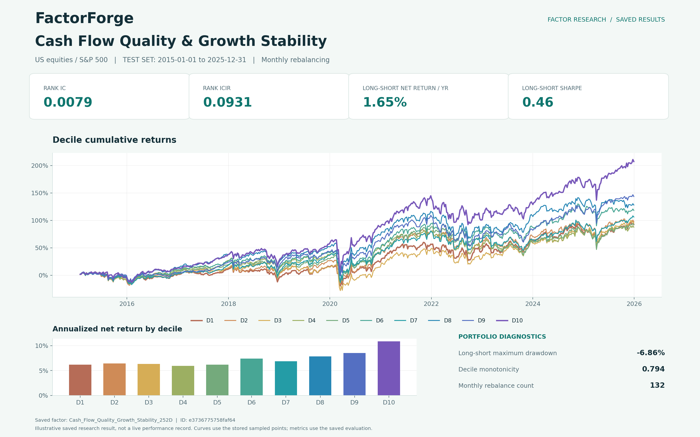
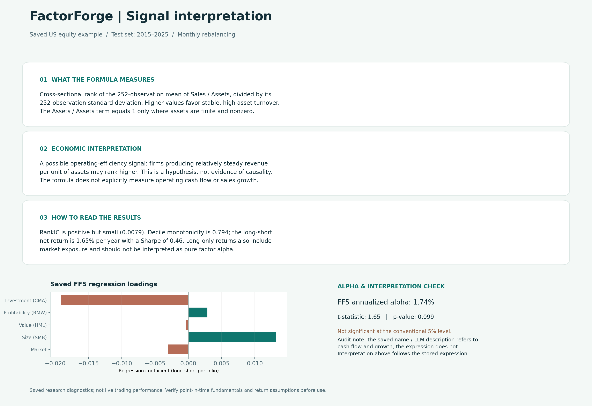
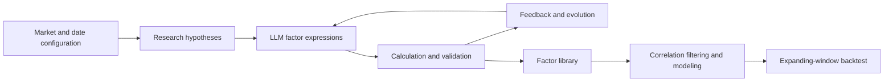

<div align="center">

# FactorForge · LLM Factor Generation

**English · [简体中文](README_ZH.md)**

**From research hypotheses to testable factors and out-of-sample portfolios.**

Generate, evaluate and organize investment factors across **US equities, China A-shares and crypto perpetuals**.


[Results](#factor-results-example) · [Features](#features) · [Markets](#markets) · [Quick start](#quick-start) · [Project structure](#project-structure)

</div>



## Factor results example

A real saved evaluation of `Cash_Flow_Quality_Growth_Stability_252D` on the S&P 500 universe: test period **2015–2025**, with **monthly rebalancing**. The figure combines ten decile return curves, annualized net returns by decile, RankIC / RankICIR and long–short diagnostics.



### Signal interpretation, exposures and statistical diagnostics



**Interpretation audit:** the stored name and LLM narrative refer to cash flow and growth, but the expression ranks the 252-observation mean-to-standard-deviation ratio of Sales / Assets. It does not explicitly use operating cash flow or sales growth. The second figure explains the actual expression and includes saved FF5 diagnostics; the FF5 alpha p-value is approximately 0.099, above the conventional 5% threshold.

This is a visualization of an existing research result, not a live trading record or a claim of typical performance. Curves use saved sampled points; summary metrics come from the saved evaluation. Selected as the first available US factor with cached split curves, without ranking by returns.

## Overview

FactorForge brings hypothesis generation, factor calculation, statistical evaluation, library management and portfolio backtesting into one web workspace. Describe an idea or select research directions, evaluate candidate signals and use validation feedback to guide subsequent iterations.

The platform source lives in [`factorforge/`](factorforge/). Its Python package retains the name `quantaalpha` for compatibility.



## Features

| Module | Capabilities |
|---|---|
| Factor research | Natural-language goals, research directions, expression generation, iterative evolution, progress and logs |
| Factor library | Separate markets and universes, historical deduplication, quality filters, ranking, batch removal and correlation heatmaps |
| Factor details | LLM explanations, train/validation/test views, grouped returns, predictive statistics and market-specific diagnostics |
| Portfolio backtests | Custom, Combined and US WRDS Kelly sources; LightGBM, PLS5 and Lasso; expanding-window fitting |
| Settings | LLM connections, data paths, market parameters, independent date splits and evaluation frequencies |
| Interface | Chinese/English switching, saved charts and statistics, reusable results and artifact cleanup |

### Research and evaluation

- **Predictiveness:** IC, RankIC and stability statistics. Crypto selection emphasizes validation RankIC / RankICIR; IC remains diagnostic.
- **Portfolio behavior:** long, short and long–short returns, quantile portfolios, Sharpe, drawdown, turnover and costs.
- **Exposures:** FF3, FF5, momentum extensions, industry and style diagnostics where supported by market data.
- **Split isolation:** validation guides selection and evolution; the test set provides final out-of-sample evaluation.
- **Correlation filtering:** identify redundant signals before building a portfolio model.

Single-factor analytics evaluate the signal itself. Independent portfolio backtests evaluate predictions and portfolios built from multiple signals.

## Markets

| Market | Universe | Data and diagnostics |
|---|---|---|
| US equities | Historical S&P 500 constituents | WRDS / CRSP / Compustat, GICS, Fama–French regressions and optional Kelly factors |
| China A-shares | CSI 300, CSI 500 and SME Composite | Local DuckDB prices, fundamentals, membership and industry data; Shenwan industries, Barra-style diagnostics and locally constructed pricing proxies |
| Crypto | Binance USDⓈ-M USDT perpetual contracts | Daily prices and available trading-activity / funding fields; contract-count and listing-age filters; separate factor library |

A-share filters can exclude contemporaneous ST stocks, newly listed stocks and securities on ChiNext, STAR Market or the Beijing Stock Exchange. Historical coverage and constituent accuracy depend on the supplied data.

Single-factor evaluation supports daily, weekly and monthly rebalancing. Portfolio rebalancing depends on the selected workflow. **Model refitting frequency and portfolio rebalancing frequency are distinct settings.**

## Quick start

### Environment and technology

| Component | Version / purpose |
|---|---|
| Python | **3.10 recommended for this setup**; package metadata requires **>=3.10** |
| Node.js | **18+** for the bundled Vite 5 toolchain; use an actively supported LTS release |
| Frontend | React 18, TypeScript 5, Vite 5, Tailwind CSS 3 |
| Backend | FastAPI >=0.109, Pydantic >=2.5.3, Uvicorn >=0.27 |
| Research engine | Qlib with LightGBM, PLS5 and Lasso workflows |
| Deployment | Linux or Windows WSL2 |

These are declared requirements, not a claim that every newer runtime has been tested. `npm ci` installs the frontend versions recorded in the lockfile. Python dependencies are defined in `factorforge/requirements.txt` and the backend requirements file.

### 1. Install the Python environment

```bash
git clone https://github.com/Haoyu-tech/FactorForge-LLM-Factor-generation.git
cd FactorForge-LLM-Factor-generation/factorforge
python3.10 -m venv .venv
source .venv/bin/activate
python -m pip install --upgrade pip
python -m pip install -e .
python -m pip install -r frontend-v2/backend/requirements.txt
cp .env.template .env
```

Edit `.env` with your provider endpoint, model, credentials and local data paths. Template paths must be adapted to your machine.

### 2. Install frontend dependencies and start the backend

```bash
cd frontend-v2
npm ci
python backend/app.py
```

### 3. Start the frontend in a second terminal

```bash
cd FactorForge-LLM-Factor-generation/factorforge/frontend-v2
npm run dev
```

Open **http://localhost:3000/**. The backend defaults to port **8000**, with API documentation at http://localhost:8000/docs.

Existing installations with a `quantaalpha` Conda environment can use `factorforge/frontend-v2/start.sh`. The Windows `Start-FactorForge.ps1` launcher expects an already configured WSL installation and service; it is not a fresh-install script.

## Workflow

1. Select a market and configure its data, universe and LLM connection.
2. Configure ordered training, validation and test periods with sufficient data coverage.
3. Enter a hypothesis or choose research directions, then follow evaluation feedback.
4. Review expressions, explanations, charts, quality and correlations in the appropriate library.
5. Select a factor source, model, quality filters and refitting interval for an expanding-window backtest.

## Data and configuration

This repository includes source code and configuration templates. **Raw databases, market files, actual API keys, installed dependencies, runtime caches and locally generated factor libraries are excluded.**

- US mode requires the corresponding WRDS data and access rights.
- A-share mode requires a local DuckDB database compatible with the adapters.
- Crypto data construction uses Binance public market APIs and depends on availability and historical coverage.
- Keep LLM credentials in your local `.env`.
- Configure paths and periods separately for each market to avoid mixing universes or cached results.

## Project structure

```text
factorforge/
├── frontend-v2/
│   ├── src/                 # React interface, state and language switching
│   ├── backend/app.py       # FastAPI endpoints and task management
│   └── start.sh             # Launcher for configured installations
├── quantaalpha/
│   ├── factors/             # Generation, calculation and evaluation
│   ├── pipeline/            # Research and evolution workflows
│   ├── backtest/            # Models, portfolios and statistics
│   ├── data/                # Market data adapters
│   ├── market/              # Market configuration and filters
│   └── llm/                 # Model integration
├── configs/
├── tests/
├── .env.template
└── PLATFORM.md
```

## Development checks

```bash
# From factorforge/, with the Python environment activated
python -m pip install pytest
python -m pytest tests -q

# Frontend type checking and production build
cd frontend-v2
npm run build
```

Existing tests cover parts of scoring and cache cleanup. They do not replace market-specific data alignment, return-methodology checks or complete backtest validation. Some legacy interface text uses a translation fallback. Results are research outputs, not a certification of trading performance.

## Foundations

FactorForge extends QuantaAlpha and preserves its package name and original author metadata. It uses Qlib, FastAPI, React and LightGBM, among other components. See the [inherited framework documentation](factorforge/README_EN.md) for the underlying project.
