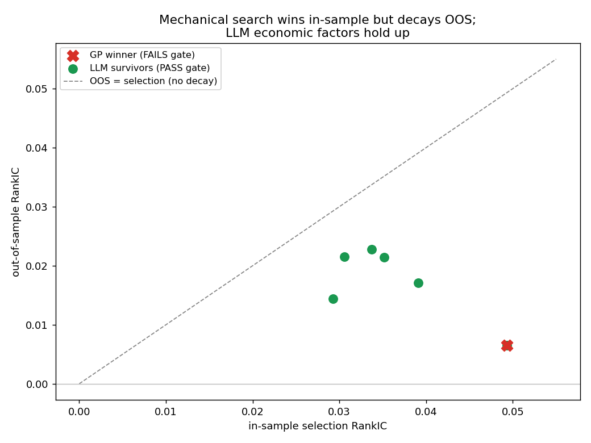
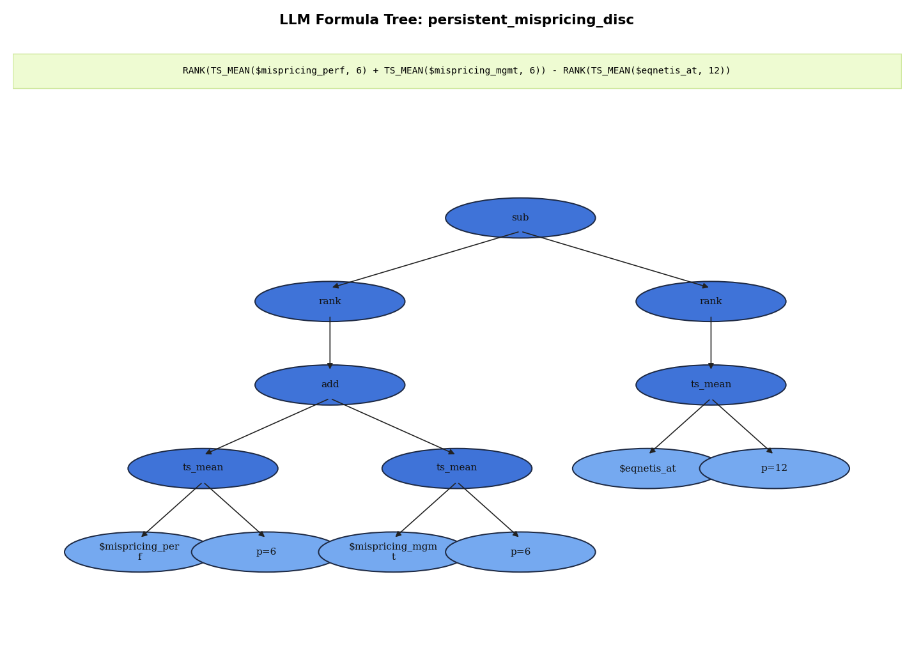
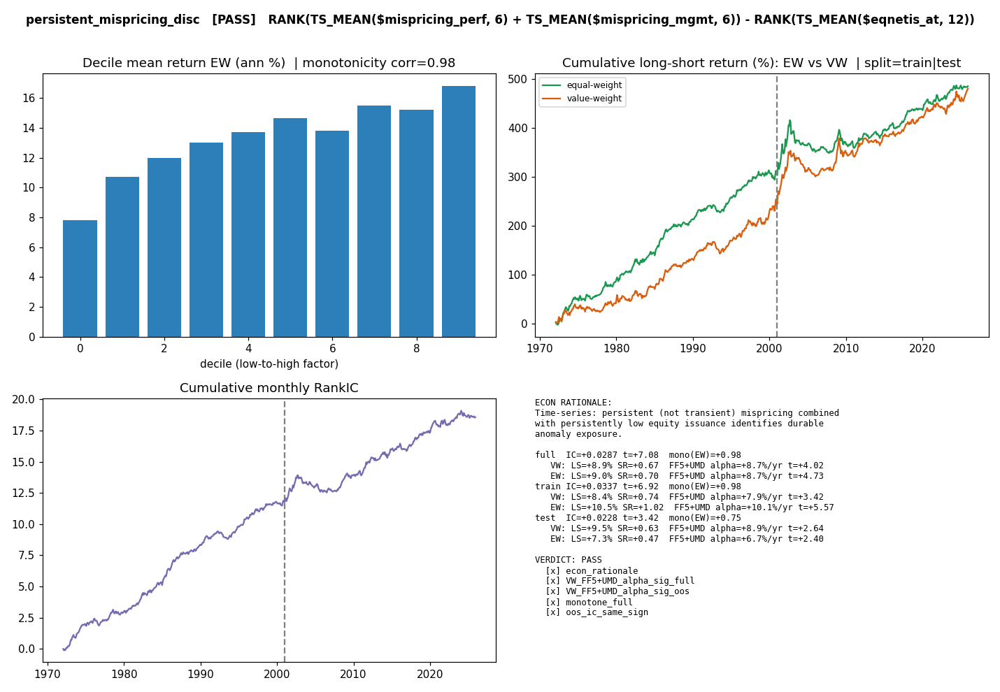

<div align="center">

# LLM-Factor

Auditable equity-factor discovery with economic hypotheses and empirical validation.

  

[Quick start](#quick-start) · [Project map](#project-map) · [Reproduction guide](docs/REPRODUCIBILITY.md)

</div>

---

## Overview

Use an LLM to propose interpretable financial hypotheses, express them in a shared factor grammar, and evaluate them against a mechanical genetic-programming baseline on a monthly S&P 500 panel.

```text
Economic hypothesis → Factor expression → Candidate ledger → Validation gate → Evidence
```

## Validation framework

| Layer | Evidence |
|---|---|
| Portfolio tests | Value-weighted long–short returns and transaction-cost sensitivity |
| Asset pricing | FF5 + momentum alphas with Newey–West statistics |
| Generalization | Locked discovery/OOS split and walk-forward analysis |
| Incremental content | Spanning regressions against published anomaly themes |
| Firm-level tests | Fama–MacBeth regressions and multiple-testing diagnostics |
| Audit trail | Candidate ledgers, formula trees and rejected candidates |

## Visual evidence



| Formula decomposition | Factor diagnostics |
|---|---|
|  |  |

## Quick start

A fresh clone needs the compatible **QuantaAlpha source**, a configured Python environment, and external WRDS-derived inputs. The upstream folder is not bundled in this checkout.

After preparing those prerequisites:

```powershell
python adapter/build_sp500_membership.py
python adapter/build_sp500_monthly_full.py
python adapter/build_sp500_monthly_kelly.py
python adapter/evaluate_ic.py '$ret_12_1'
```

Keep dollar-prefixed expressions in single quotes in PowerShell. Offline evaluation of stored formulas is separate from live LLM candidate generation, which also requires provider configuration.

## Project map

| Path | Role |
|---|---|
| [adapter/README.md](adapter/README.md) | Monthly-panel adapter and evaluation workflow |
| [llm_factor/](llm_factor/) | Configuration, grammar, ledgers and supporting utilities |
| [configs/](configs/) | Research configuration |
| [results/formal/README.md](results/formal/README.md) | Recorded formal comparison and survivor diagnostics |
| [results/](results/) | Formula trees, reports, ledgers and experiment artifacts |

## Reading the results

The stored experiments compare in-sample selection and out-of-sample validation. Some candidate factors survive the gate while others fail or become weak after neutrality and costs. Results depend on the candidate pool, discovery budget, data vintage and evaluation definitions.

See [formal results](results/formal/README.md) for the recorded tables and [the detailed research reference](docs/PROJECT_REFERENCE.md) for the original narrative, expressions and citations. The repository's empirical claims have not been independently rerun during this edit.

## Data

WRDS, CRSP and Compustat inputs are licensed and external. Preserve source versions, panel fingerprints, upstream commits and discovery ledgers when comparing runs.

## Documentation

- [Reproduction guide](docs/REPRODUCIBILITY.md): inputs, execution order and validation limits.
- [Code and artifact map](docs/REPOSITORY_MAP.md): source and configuration paths.

<sub>Research artifacts reflect the recorded experiment settings. Full results were not regenerated during documentation cleanup.</sub>
