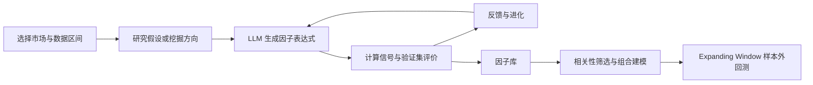

<div align="center">

# FactorForge · 因子智研

**从研究假设，到可检验的因子，再到样本外组合回测。**

面向美股、A 股与 Crypto 永续合约的 LLM 因子研究平台。


[平台功能](#平台功能) · [支持市场](#支持市场) · [快速部署](#快速部署) · [代码结构](#代码结构) · [English guide](factorforge/PLATFORM.md)

</div>

---

## 平台简介

FactorForge 将大语言模型驱动的因子生成、公式计算、统计评价、因子库管理和组合回测放到同一个网页工作台中。

输入研究思路或勾选挖掘方向后，平台生成候选假设与因子表达式，计算信号并评价结果，再将反馈用于后续迭代。因子库保存公式、评价信息及可用的曲线与统计结果，支持进一步筛选和独立回测。

**平台主代码位于 [`factorforge/`](factorforge/)。** 前端采用 FactorForge 品牌，底层 Python 包保留 `quantaalpha` 名称以兼容现有代码。



## 平台功能

| 模块 | 功能 |
|---|---|
| **因子挖掘** | 自然语言研究需求、自选方向、候选公式生成、多轮进化、任务进度与日志 |
| **因子库** | 按市场与股票池分库、历史合并去重、质量筛选与排序、批量删除、相关性热力图 |
| **因子详情** | LLM 解释、训练/验证/测试区间切换、分组收益曲线、预测统计与市场相关诊断 |
| **组合回测** | Custom、Combined 与美股 WRDS Kelly 因子源；LightGBM、PLS5、Lasso；扩张窗口训练 |
| **系统设置** | LLM 接口、数据路径、市场参数、独立时间区间、挖掘方向与评价频率 |
| **使用体验** | 中文/英文切换、结果缓存、已完成统计复用、运行产物保留与清理 |

### 研究与评价

- **预测能力**：IC、RankIC 及其稳定性统计；Crypto 筛选侧重验证集 RankIC / RankICIR，IC 用于诊断。
- **组合表现**：Long、Short、Long–Short、分组收益、Sharpe、回撤、换手与成本。
- **资产定价与暴露**：根据市场和可用数据计算 FF3、FF5、动量扩展、行业或风格诊断。
- **区间隔离**：验证集用于筛选和进化反馈；测试集用于最终样本外评价。
- **相关性筛选**：识别重复度较高的因子，减少组合输入冗余。

因子详情的单因子评价与独立回测的组合模型是两个层次：前者研究信号本身，后者研究多个信号组合后的预测与投资组合表现。

## 支持市场

| 市场 | 标的范围 | 数据与评价 |
|---|---|---|
| **美股** | 历史 S&P 500 成分股 | WRDS / CRSP / Compustat；GICS 行业处理；Fama–French 相关回归；可选 Kelly 因子源 |
| **A 股** | 沪深300、中证500、中小综指 | 本地 DuckDB 日频量价、财务、成分与行业数据；申万行业、Barra 风格诊断及本地资产定价代理 |
| **Crypto** | 币安 USDⓈ-M、USDT 本位永续合约 | 日频行情与可用的交易行为/资金费率字段；合约数量和上市天数筛选；独立因子库 |

A 股可配置剔除当期 ST、上市不足指定交易日的新股，以及创业板、科创板和北交所标的。具体数据覆盖与历史成分精度取决于接入的数据源。

单因子评价支持日、周、月调仓口径。组合回测的调仓频率取决于所选流程；**模型重训间隔不等于组合调仓间隔**。

## 快速部署

推荐使用 **Linux / Windows WSL2、Python 3.10、Node.js 18+**。以下为手动启动方式，不依赖本机已有的系统服务。

### 1. 获取代码并安装 Python 依赖

```bash
git clone https://github.com/Haoyu-tech/LLM---Factor-generation.git
cd LLM---Factor-generation/factorforge

python3.10 -m venv .venv
source .venv/bin/activate
python -m pip install --upgrade pip
python -m pip install -e .
python -m pip install -r frontend-v2/backend/requirements.txt

cp .env.template .env
```

编辑 `.env`，填写自己的 LLM 服务地址、模型名称和凭据，并设置本机的数据路径。模板中的路径需要按实际环境修改。

### 2. 安装前端依赖并启动后端

```bash
cd frontend-v2
npm ci
python backend/app.py
```

### 3. 在另一个终端启动前端

```bash
cd LLM---Factor-generation/factorforge/frontend-v2
npm run dev
```

打开 **http://localhost:3000/**。后端默认端口为 **8000**，接口文档位于 http://localhost:8000/docs。

已有 `quantaalpha` Conda 环境时，也可使用 `factorforge/frontend-v2/start.sh`。Windows 的 `Start-FactorForge.ps1` 用于已配置的 WSL 与 `quantaalpha.service`，不是新机器的一键安装脚本。

## 使用流程

1. **配置数据与模型**：进入系统设置，选择市场，配置 LLM、数据目录和相应股票池或合约池。
2. **设置时间区间**：分别配置训练集、验证集与测试集，检查顺序及数据覆盖。
3. **开始研究**：输入研究假设，或从挖掘方向中选择目标，观察任务进度与评价反馈。
4. **检查因子**：在对应市场因子库中查看公式、解释、统计与曲线，比较质量和相关性。
5. **独立回测**：选择因子源、模型、质量筛选与重训间隔，执行 Expanding Window 回测。

## 数据与配置

仓库提供源码与配置模板。**原始数据库、行情文件、实际 API 密钥、已安装依赖、运行缓存和本地生成的因子库不随平台源码发布。**

- 美股模式需要自行准备对应 WRDS 数据与访问权限。
- A 股模式需要符合适配器结构的本地 DuckDB 数据。
- Crypto 模式使用币安公开行情接口；数据构建依赖接口可达性与历史覆盖。
- LLM 凭据保存在本机 `.env` 中。
- 各市场的数据路径和日期区间应分别配置，避免跨市场复用错误的股票池或缓存。

## 代码结构

```text
factorforge/
├── frontend-v2/
│   ├── src/                 # React 界面、页面状态与语言切换
│   ├── backend/app.py       # FastAPI 接口与任务管理
│   └── start.sh             # 已配置环境的服务启动入口
├── quantaalpha/
│   ├── factors/             # 因子生成、计算、评价与反馈
│   ├── pipeline/            # 挖掘与进化流程
│   ├── backtest/            # 模型训练、组合回测与统计
│   ├── data/                # 市场数据适配器源码
│   ├── market/              # 市场配置与过滤规则
│   └── llm/                 # 模型调用
├── configs/                 # 回测与实验配置
├── tests/                   # 现有自动化测试
├── .env.template            # 本地环境配置模板
└── PLATFORM.md              # 英文部署与平台说明
```

## 开发检查

```bash
# 在 factorforge/ 下，激活 Python 环境后执行
python -m pip install pytest
python -m pytest tests -q

# 前端类型检查与生产构建
cd frontend-v2
npm run build
```

目前的自动化测试覆盖部分评分与缓存清理逻辑，不能替代各市场数据对齐、收益口径和完整回测的验证。

## 项目基础

FactorForge 基于 QuantaAlpha 代码扩展，保留其 Python 包名和原作者元数据，并使用 Qlib、FastAPI、React、LightGBM 等组件。底层框架文档见 [`factorforge/README_EN.md`](factorforge/README_EN.md)。
