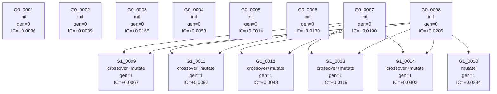

# Full GP Evolution Lineage

## Nodes

- `G0_0001` gen=0 op=init score=0.0035927400191636265 expr=`-RANK($bidaskhl_21d) -RANK(((TS_STD($sale_me, 36) * $seas_1_1na) - SCALE($dbnetis_at)))`
- `G0_0002` gen=0 op=init score=0.0038927931879396576 expr=`-RANK(TS_MAX(TS_PCTCHANGE(TS_PCTCHANGE($at_gr1, 3), 3), 24))`
- `G0_0003` gen=0 op=init score=0.016515399945556994 expr=`RANK(ZSCORE($eqnetis_at)) +RANK(TS_ZSCORE($mispricing_mgmt, 36)) -RANK($eqnetis_at)`
- `G0_0004` gen=0 op=init score=0.005306650219699605 expr=`RANK(($dbnetis_at - TS_MIN(DELTA($rvol_21d, 12), 36))) +RANK($op_at)`
- `G0_0005` gen=0 op=init score=0.0014406732680083808 expr=`-RANK((RANK($be_me) / TS_PCTCHANGE($qmj_prof, 36)))`
- `G0_0006` gen=0 op=init score=0.013037993828585606 expr=`-RANK(TS_SUM(TS_SUM($return, 6), 6)) +RANK((TS_MEAN($eqnpo_12m, 3) - ($mispricing_mgmt + TS_MAX($ret_6_1, 36))))`
- `G0_0007` gen=0 op=init score=0.018972052981317683 expr=`RANK(((TS_ZSCORE($ret_6_1, 3) / $ni_be) + ($betadown_252d * TS_MIN($resff3_12_1, 12)))) -RANK($bidaskhl_21d) +RANK(($ami_126d - ($ret_12_7 - TS_MIN($eqnpo_12m, 3))))`
- `G0_0008` gen=0 op=init score=0.02047172049430342 expr=`-RANK((SIGN(TS_MIN($qmj_safety, 6)) + ($ret_12_1 - $qmj_prof))) -RANK((ABS(DELTA($chcsho_12m, 3)) + TS_ZSCORE(DELAY($qmj_prof, 24), 36))) -RANK(TS_MEAN($mispricing_mgmt, 6))`
- `G1_0009` gen=1 op=crossover+mutate score=0.006747224614106324 expr=`RANK($bidaskhl_21d)`
- `G1_0010` gen=1 op=mutate score=0.02339578629998904 expr=`-RANK((SIGN(TS_MIN($qmj_safety, 6)) + ($ret_12_1 - $qmj_prof))) -RANK(TS_MEAN($mispricing_mgmt, 6))`
- `G1_0011` gen=1 op=crossover+mutate score=0.009207489538030543 expr=`-RANK(TS_STD($volume, 12))`
- `G1_0012` gen=1 op=crossover+mutate score=0.004281889823125629 expr=`-RANK(TS_MEAN($mispricing_mgmt, 6)) -RANK((ABS(DELTA($chcsho_12m, 3)) + TS_ZSCORE(DELAY($qmj_prof, 24), 36))) +RANK((TS_SUM($ni_me, 12) + $ni_be))`
- `G1_0013` gen=1 op=crossover+mutate score=0.011898825241632991 expr=`RANK(((TS_ZSCORE($ret_6_1, 3) / $ni_be) + ($betadown_252d * TS_MIN($resff3_12_1, 12)))) -RANK($bidaskhl_21d) -RANK(($ami_126d - ($ret_12_7 - TS_MIN($eqnpo_12m, 3))))`
- `G1_0014` gen=1 op=crossover+mutate score=0.03023079550727499 expr=`-RANK(TS_MEAN($mispricing_mgmt, 6)) +RANK(($ami_126d - ($ret_12_7 - TS_MIN($eqnpo_12m, 3)))) +RANK(TS_MEAN($bev_mev, 12))`