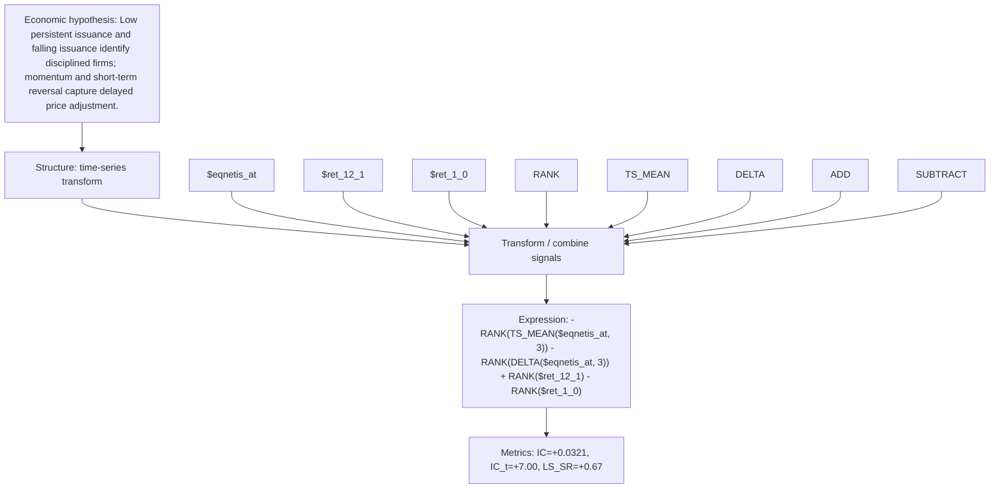

# strict_issuance_change_mom_eqnetis_at_3_ret_12_1

- **Family:** `strict_issuance_momentum`
- **Structure:** time-series transform
- **Fields:** `$eqnetis_at, $ret_12_1, $ret_1_0`
- **Operators:** `RANK, TS_MEAN, DELTA, ADD, SUBTRACT`
- **Expression:** `-RANK(TS_MEAN($eqnetis_at, 3)) - RANK(DELTA($eqnetis_at, 3)) + RANK($ret_12_1) - RANK($ret_1_0)`
- **Metrics:** IC=+0.0321, IC_t=+7.00, LS_SR=+0.67