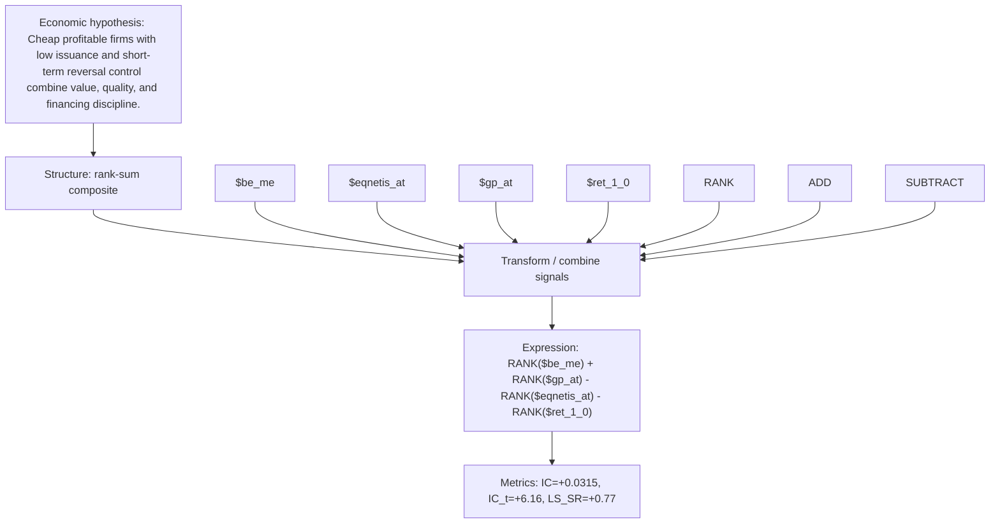

# strict_value_quality_issue_be_me_gp_at_eqnetis_at

- **Family:** `strict_value_quality_issuance`
- **Structure:** rank-sum composite
- **Fields:** `$be_me, $eqnetis_at, $gp_at, $ret_1_0`
- **Operators:** `RANK, ADD, SUBTRACT`
- **Expression:** `RANK($be_me) + RANK($gp_at) - RANK($eqnetis_at) - RANK($ret_1_0)`
- **Metrics:** IC=+0.0315, IC_t=+6.16, LS_SR=+0.77