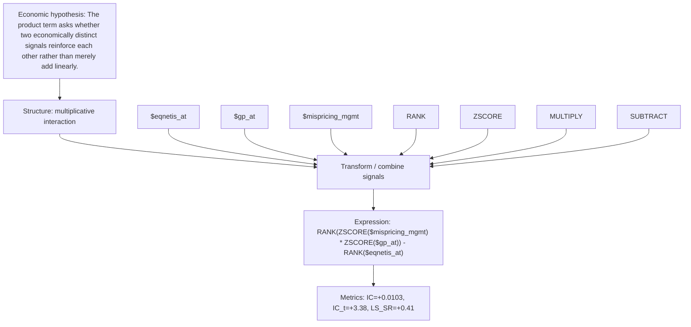

# interaction_mispr_gp

- **Family:** `multiplicative_interaction`
- **Structure:** multiplicative interaction
- **Fields:** `$eqnetis_at, $gp_at, $mispricing_mgmt`
- **Operators:** `RANK, ZSCORE, MULTIPLY, SUBTRACT`
- **Expression:** `RANK(ZSCORE($mispricing_mgmt) * ZSCORE($gp_at)) - RANK($eqnetis_at)`
- **Metrics:** IC=+0.0103, IC_t=+3.38, LS_SR=+0.41