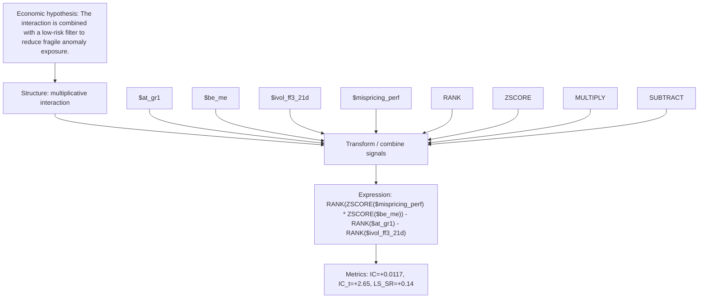

# interaction_mispr_value_lowrisk

- **Family:** `multiplicative_interaction`
- **Structure:** multiplicative interaction
- **Fields:** `$at_gr1, $be_me, $ivol_ff3_21d, $mispricing_perf`
- **Operators:** `RANK, ZSCORE, MULTIPLY, SUBTRACT`
- **Expression:** `RANK(ZSCORE($mispricing_perf) * ZSCORE($be_me)) - RANK($at_gr1) - RANK($ivol_ff3_21d)`
- **Metrics:** IC=+0.0117, IC_t=+2.65, LS_SR=+0.14