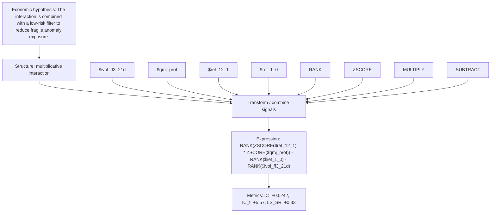

# interaction_mom_quality_lowrisk

- **Family:** `multiplicative_interaction`
- **Structure:** multiplicative interaction
- **Fields:** `$ivol_ff3_21d, $qmj_prof, $ret_12_1, $ret_1_0`
- **Operators:** `RANK, ZSCORE, MULTIPLY, SUBTRACT`
- **Expression:** `RANK(ZSCORE($ret_12_1) * ZSCORE($qmj_prof)) - RANK($ret_1_0) - RANK($ivol_ff3_21d)`
- **Metrics:** IC=+0.0242, IC_t=+5.57, LS_SR=+0.33