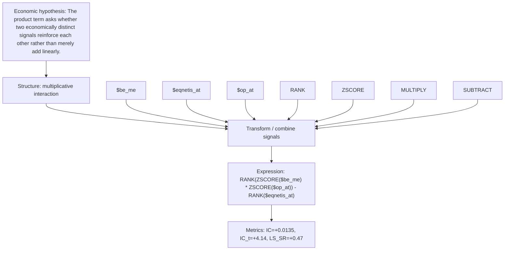

# interaction_value_prof

- **Family:** `multiplicative_interaction`
- **Structure:** multiplicative interaction
- **Fields:** `$be_me, $eqnetis_at, $op_at`
- **Operators:** `RANK, ZSCORE, MULTIPLY, SUBTRACT`
- **Expression:** `RANK(ZSCORE($be_me) * ZSCORE($op_at)) - RANK($eqnetis_at)`
- **Metrics:** IC=+0.0135, IC_t=+4.14, LS_SR=+0.47