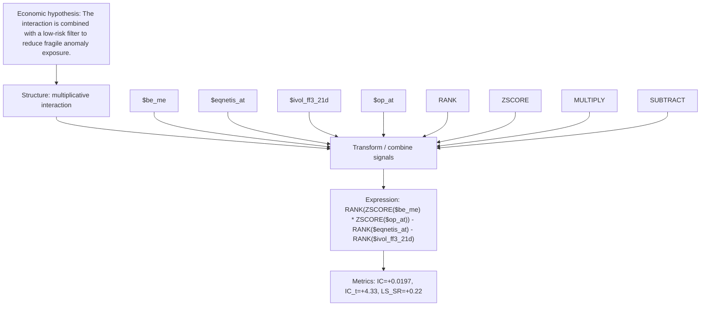

# interaction_value_prof_lowrisk

- **Family:** `multiplicative_interaction`
- **Structure:** multiplicative interaction
- **Fields:** `$be_me, $eqnetis_at, $ivol_ff3_21d, $op_at`
- **Operators:** `RANK, ZSCORE, MULTIPLY, SUBTRACT`
- **Expression:** `RANK(ZSCORE($be_me) * ZSCORE($op_at)) - RANK($eqnetis_at) - RANK($ivol_ff3_21d)`
- **Metrics:** IC=+0.0197, IC_t=+4.33, LS_SR=+0.22