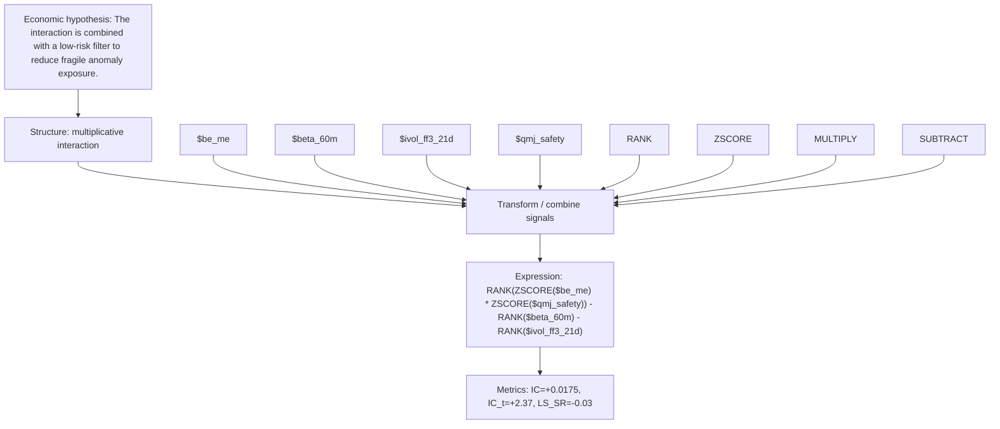

# interaction_value_safety_lowrisk

- **Family:** `multiplicative_interaction`
- **Structure:** multiplicative interaction
- **Fields:** `$be_me, $beta_60m, $ivol_ff3_21d, $qmj_safety`
- **Operators:** `RANK, ZSCORE, MULTIPLY, SUBTRACT`
- **Expression:** `RANK(ZSCORE($be_me) * ZSCORE($qmj_safety)) - RANK($beta_60m) - RANK($ivol_ff3_21d)`
- **Metrics:** IC=+0.0175, IC_t=+2.37, LS_SR=-0.03