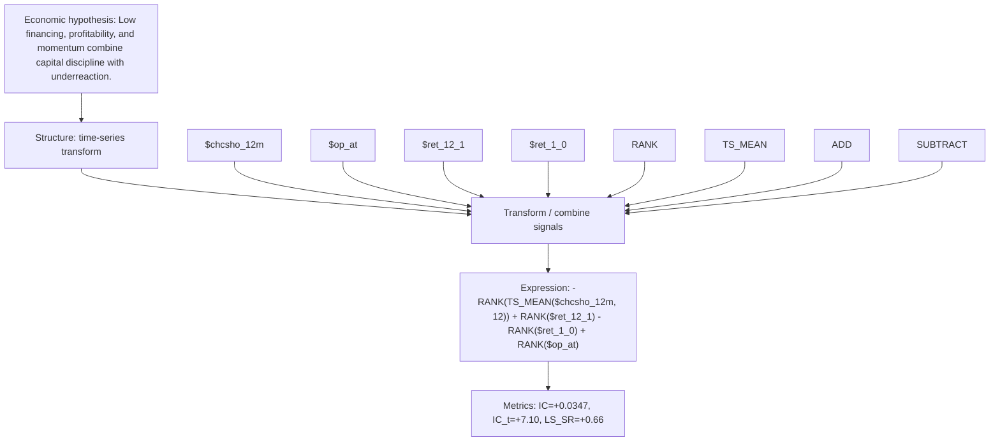

# issuance_disc_quality_mom_chcsho_12m_12

- **Family:** `issuance_momentum_ts`
- **Structure:** time-series transform
- **Fields:** `$chcsho_12m, $op_at, $ret_12_1, $ret_1_0`
- **Operators:** `RANK, TS_MEAN, ADD, SUBTRACT`
- **Expression:** `-RANK(TS_MEAN($chcsho_12m, 12)) + RANK($ret_12_1) - RANK($ret_1_0) + RANK($op_at)`
- **Metrics:** IC=+0.0347, IC_t=+7.10, LS_SR=+0.66