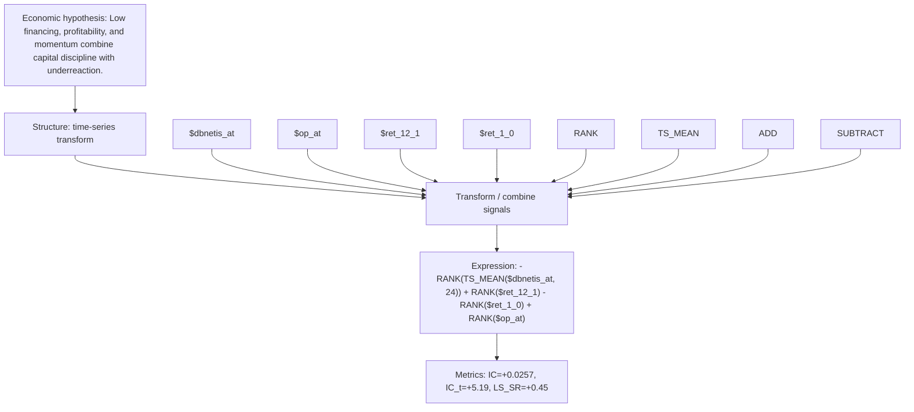

# issuance_disc_quality_mom_dbnetis_at_24

- **Family:** `issuance_momentum_ts`
- **Structure:** time-series transform
- **Fields:** `$dbnetis_at, $op_at, $ret_12_1, $ret_1_0`
- **Operators:** `RANK, TS_MEAN, ADD, SUBTRACT`
- **Expression:** `-RANK(TS_MEAN($dbnetis_at, 24)) + RANK($ret_12_1) - RANK($ret_1_0) + RANK($op_at)`
- **Metrics:** IC=+0.0257, IC_t=+5.19, LS_SR=+0.45