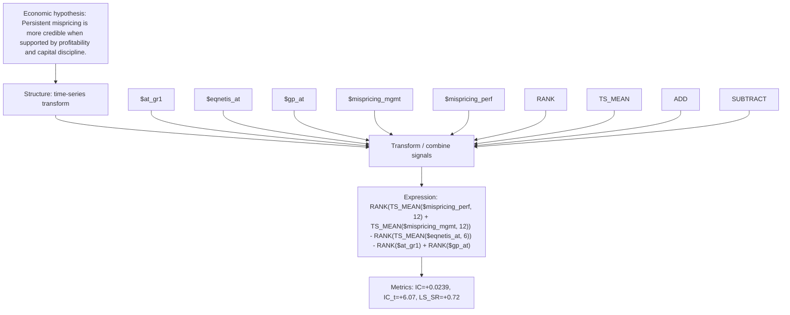

# mispr_ts_fin_qual_12_6

- **Family:** `mispricing_financing_ts`
- **Structure:** time-series transform
- **Fields:** `$at_gr1, $eqnetis_at, $gp_at, $mispricing_mgmt, $mispricing_perf`
- **Operators:** `RANK, TS_MEAN, ADD, SUBTRACT`
- **Expression:** `RANK(TS_MEAN($mispricing_perf, 12) + TS_MEAN($mispricing_mgmt, 12)) - RANK(TS_MEAN($eqnetis_at, 6)) - RANK($at_gr1) + RANK($gp_at)`
- **Metrics:** IC=+0.0239, IC_t=+6.07, LS_SR=+0.72