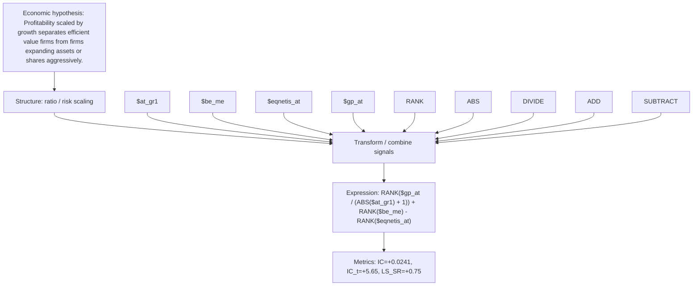

# profit_to_growth_value_gp_at_at_gr1

- **Family:** `profitability_efficiency_ratio`
- **Structure:** ratio / risk scaling
- **Fields:** `$at_gr1, $be_me, $eqnetis_at, $gp_at`
- **Operators:** `RANK, ABS, DIVIDE, ADD, SUBTRACT`
- **Expression:** `RANK($gp_at / (ABS($at_gr1) + 1)) + RANK($be_me) - RANK($eqnetis_at)`
- **Metrics:** IC=+0.0241, IC_t=+5.65, LS_SR=+0.75