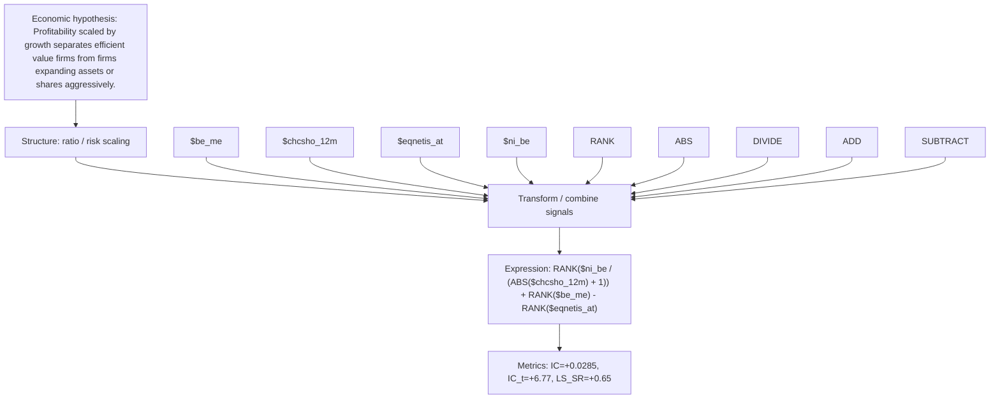

# profit_to_growth_value_ni_be_chcsho_12m

- **Family:** `profitability_efficiency_ratio`
- **Structure:** ratio / risk scaling
- **Fields:** `$be_me, $chcsho_12m, $eqnetis_at, $ni_be`
- **Operators:** `RANK, ABS, DIVIDE, ADD, SUBTRACT`
- **Expression:** `RANK($ni_be / (ABS($chcsho_12m) + 1)) + RANK($be_me) - RANK($eqnetis_at)`
- **Metrics:** IC=+0.0285, IC_t=+6.77, LS_SR=+0.65