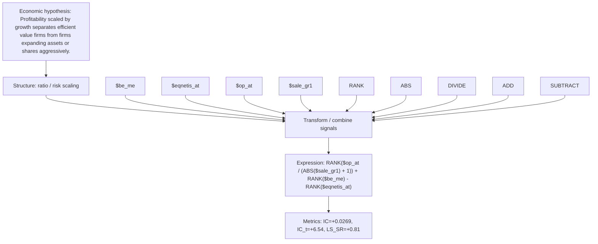

# profit_to_growth_value_op_at_sale_gr1

- **Family:** `profitability_efficiency_ratio`
- **Structure:** ratio / risk scaling
- **Fields:** `$be_me, $eqnetis_at, $op_at, $sale_gr1`
- **Operators:** `RANK, ABS, DIVIDE, ADD, SUBTRACT`
- **Expression:** `RANK($op_at / (ABS($sale_gr1) + 1)) + RANK($be_me) - RANK($eqnetis_at)`
- **Metrics:** IC=+0.0269, IC_t=+6.54, LS_SR=+0.81