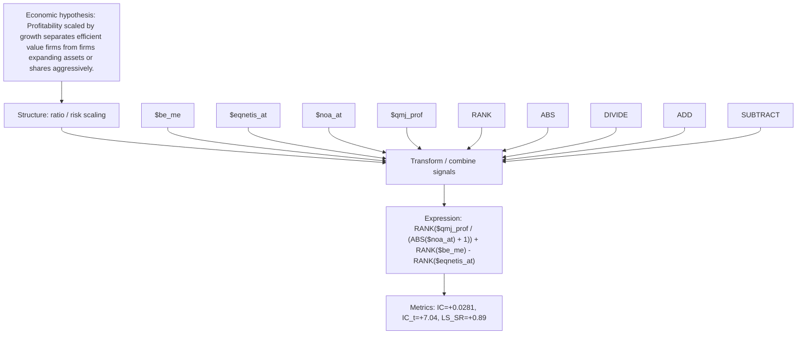

# profit_to_growth_value_qmj_prof_noa_at

- **Family:** `profitability_efficiency_ratio`
- **Structure:** ratio / risk scaling
- **Fields:** `$be_me, $eqnetis_at, $noa_at, $qmj_prof`
- **Operators:** `RANK, ABS, DIVIDE, ADD, SUBTRACT`
- **Expression:** `RANK($qmj_prof / (ABS($noa_at) + 1)) + RANK($be_me) - RANK($eqnetis_at)`
- **Metrics:** IC=+0.0281, IC_t=+7.04, LS_SR=+0.89