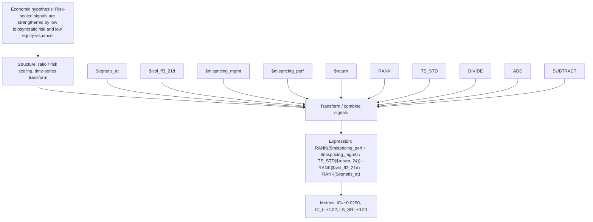

# risk_scaled_mispricing_fin_24

- **Family:** `risk_scaled_ratio`
- **Structure:** ratio / risk scaling, time-series transform
- **Fields:** `$eqnetis_at, $ivol_ff3_21d, $mispricing_mgmt, $mispricing_perf, $return`
- **Operators:** `RANK, TS_STD, DIVIDE, ADD, SUBTRACT`
- **Expression:** `RANK(($mispricing_perf + $mispricing_mgmt) / TS_STD($return, 24)) - RANK($ivol_ff3_21d) - RANK($eqnetis_at)`
- **Metrics:** IC=+0.0290, IC_t=+4.32, LS_SR=+0.20