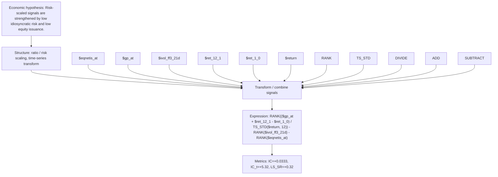

# risk_scaled_quality_mom_fin_12

- **Family:** `risk_scaled_ratio`
- **Structure:** ratio / risk scaling, time-series transform
- **Fields:** `$eqnetis_at, $gp_at, $ivol_ff3_21d, $ret_12_1, $ret_1_0, $return`
- **Operators:** `RANK, TS_STD, DIVIDE, ADD, SUBTRACT`
- **Expression:** `RANK(($gp_at + $ret_12_1 - $ret_1_0) / TS_STD($return, 12)) - RANK($ivol_ff3_21d) - RANK($eqnetis_at)`
- **Metrics:** IC=+0.0333, IC_t=+5.32, LS_SR=+0.32