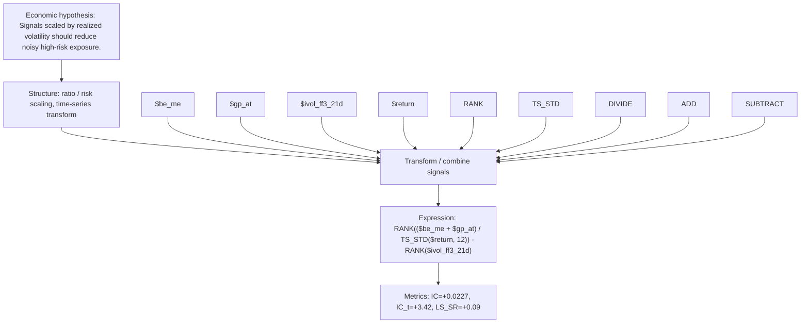

# risk_scaled_value_quality_12

- **Family:** `risk_scaled_ratio`
- **Structure:** ratio / risk scaling, time-series transform
- **Fields:** `$be_me, $gp_at, $ivol_ff3_21d, $return`
- **Operators:** `RANK, TS_STD, DIVIDE, ADD, SUBTRACT`
- **Expression:** `RANK(($be_me + $gp_at) / TS_STD($return, 12)) - RANK($ivol_ff3_21d)`
- **Metrics:** IC=+0.0227, IC_t=+3.42, LS_SR=+0.09