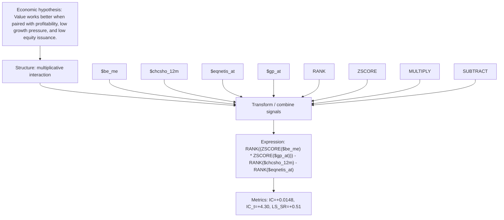

# value_profit_growth_product_gp_at_chcsho_12m

- **Family:** `profitability_efficiency_interaction`
- **Structure:** multiplicative interaction
- **Fields:** `$be_me, $chcsho_12m, $eqnetis_at, $gp_at`
- **Operators:** `RANK, ZSCORE, MULTIPLY, SUBTRACT`
- **Expression:** `RANK((ZSCORE($be_me) * ZSCORE($gp_at))) - RANK($chcsho_12m) - RANK($eqnetis_at)`
- **Metrics:** IC=+0.0148, IC_t=+4.30, LS_SR=+0.51