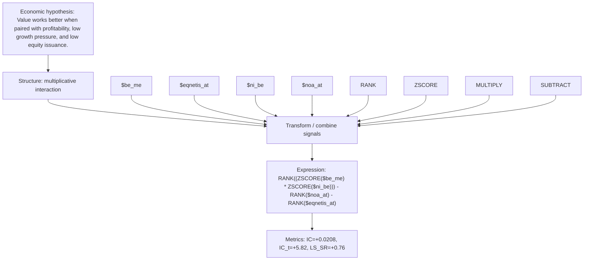

# value_profit_growth_product_ni_be_noa_at

- **Family:** `profitability_efficiency_interaction`
- **Structure:** multiplicative interaction
- **Fields:** `$be_me, $eqnetis_at, $ni_be, $noa_at`
- **Operators:** `RANK, ZSCORE, MULTIPLY, SUBTRACT`
- **Expression:** `RANK((ZSCORE($be_me) * ZSCORE($ni_be))) - RANK($noa_at) - RANK($eqnetis_at)`
- **Metrics:** IC=+0.0208, IC_t=+5.82, LS_SR=+0.76