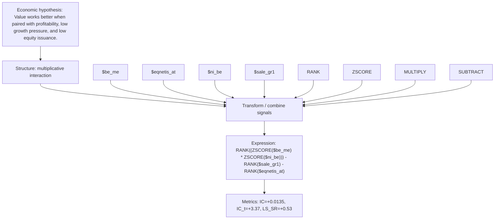

# value_profit_growth_product_ni_be_sale_gr1

- **Family:** `profitability_efficiency_interaction`
- **Structure:** multiplicative interaction
- **Fields:** `$be_me, $eqnetis_at, $ni_be, $sale_gr1`
- **Operators:** `RANK, ZSCORE, MULTIPLY, SUBTRACT`
- **Expression:** `RANK((ZSCORE($be_me) * ZSCORE($ni_be))) - RANK($sale_gr1) - RANK($eqnetis_at)`
- **Metrics:** IC=+0.0135, IC_t=+3.37, LS_SR=+0.53