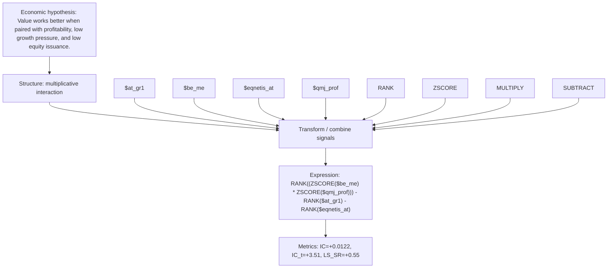

# value_profit_growth_product_qmj_prof_at_gr1

- **Family:** `profitability_efficiency_interaction`
- **Structure:** multiplicative interaction
- **Fields:** `$at_gr1, $be_me, $eqnetis_at, $qmj_prof`
- **Operators:** `RANK, ZSCORE, MULTIPLY, SUBTRACT`
- **Expression:** `RANK((ZSCORE($be_me) * ZSCORE($qmj_prof))) - RANK($at_gr1) - RANK($eqnetis_at)`
- **Metrics:** IC=+0.0122, IC_t=+3.51, LS_SR=+0.55