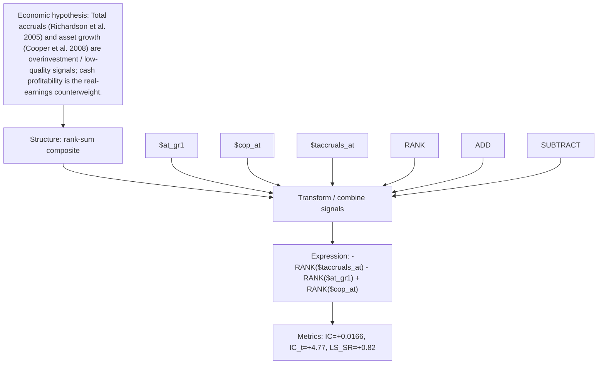

# accrual_investment_discipline

- **Family:** `llm`
- **Structure:** rank-sum composite
- **Fields:** `$at_gr1, $cop_at, $taccruals_at`
- **Operators:** `RANK, ADD, SUBTRACT`
- **Expression:** `-RANK($taccruals_at) - RANK($at_gr1) + RANK($cop_at)`
- **Metrics:** IC=+0.0166, IC_t=+4.77, LS_SR=+0.82