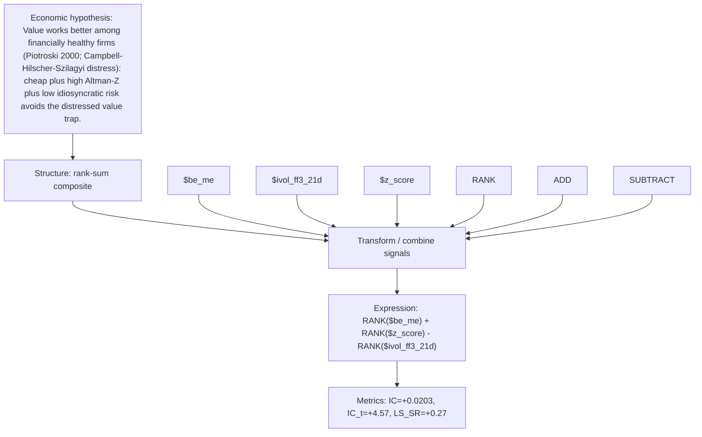

# distress_adjusted_value

- **Family:** `llm`
- **Structure:** rank-sum composite
- **Fields:** `$be_me, $ivol_ff3_21d, $z_score`
- **Operators:** `RANK, ADD, SUBTRACT`
- **Expression:** `RANK($be_me) + RANK($z_score) - RANK($ivol_ff3_21d)`
- **Metrics:** IC=+0.0203, IC_t=+4.57, LS_SR=+0.27