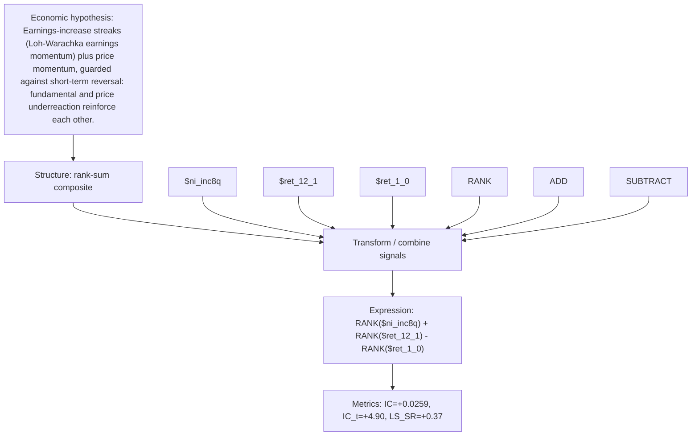

# earnings_streak_momentum

- **Family:** `llm`
- **Structure:** rank-sum composite
- **Fields:** `$ni_inc8q, $ret_12_1, $ret_1_0`
- **Operators:** `RANK, ADD, SUBTRACT`
- **Expression:** `RANK($ni_inc8q) + RANK($ret_12_1) - RANK($ret_1_0)`
- **Metrics:** IC=+0.0259, IC_t=+4.90, LS_SR=+0.37