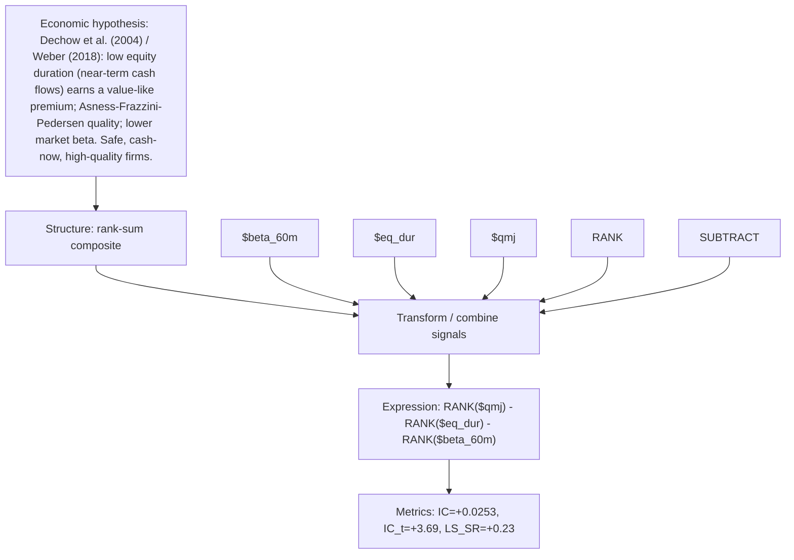

# low_duration_quality

- **Family:** `llm`
- **Structure:** rank-sum composite
- **Fields:** `$beta_60m, $eq_dur, $qmj`
- **Operators:** `RANK, SUBTRACT`
- **Expression:** `RANK($qmj) - RANK($eq_dur) - RANK($beta_60m)`
- **Metrics:** IC=+0.0253, IC_t=+3.69, LS_SR=+0.23