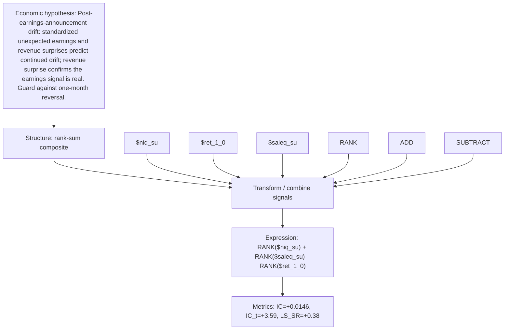

# pead_earnings_revenue_surprise

- **Family:** `llm`
- **Structure:** rank-sum composite
- **Fields:** `$niq_su, $ret_1_0, $saleq_su`
- **Operators:** `RANK, ADD, SUBTRACT`
- **Expression:** `RANK($niq_su) + RANK($saleq_su) - RANK($ret_1_0)`
- **Metrics:** IC=+0.0146, IC_t=+3.59, LS_SR=+0.38