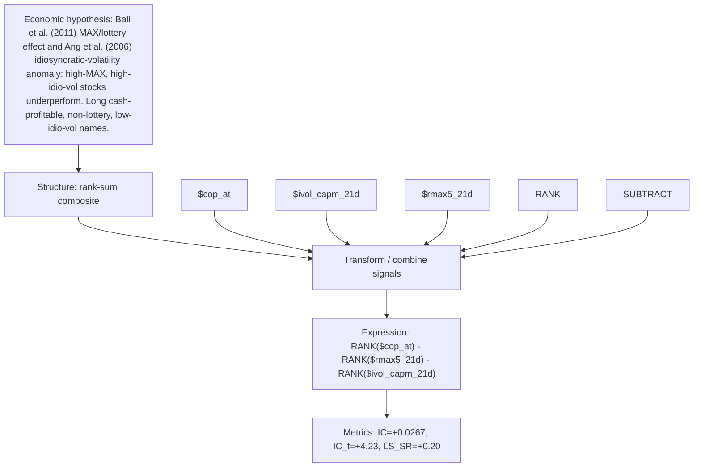

# profitability_minus_lottery

- **Family:** `llm`
- **Structure:** rank-sum composite
- **Fields:** `$cop_at, $ivol_capm_21d, $rmax5_21d`
- **Operators:** `RANK, SUBTRACT`
- **Expression:** `RANK($cop_at) - RANK($rmax5_21d) - RANK($ivol_capm_21d)`
- **Metrics:** IC=+0.0267, IC_t=+4.23, LS_SR=+0.20