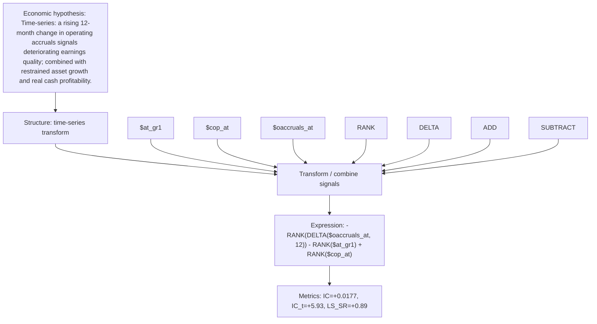

# accrual_deterioration_guard

- **Family:** `llm`
- **Structure:** time-series transform
- **Fields:** `$at_gr1, $cop_at, $oaccruals_at`
- **Operators:** `RANK, DELTA, ADD, SUBTRACT`
- **Expression:** `-RANK(DELTA($oaccruals_at, 12)) - RANK($at_gr1) + RANK($cop_at)`
- **Metrics:** IC=+0.0177, IC_t=+5.93, LS_SR=+0.89