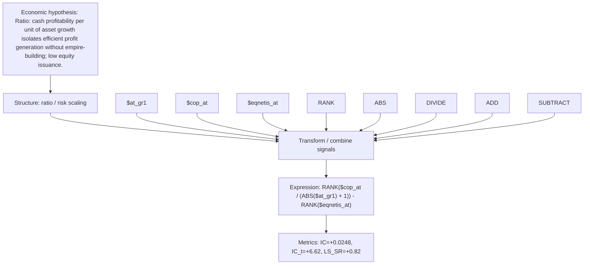

# cashprof_per_investment

- **Family:** `llm`
- **Structure:** ratio / risk scaling
- **Fields:** `$at_gr1, $cop_at, $eqnetis_at`
- **Operators:** `RANK, ABS, DIVIDE, ADD, SUBTRACT`
- **Expression:** `RANK($cop_at / (ABS($at_gr1) + 1)) - RANK($eqnetis_at)`
- **Metrics:** IC=+0.0248, IC_t=+6.62, LS_SR=+0.82