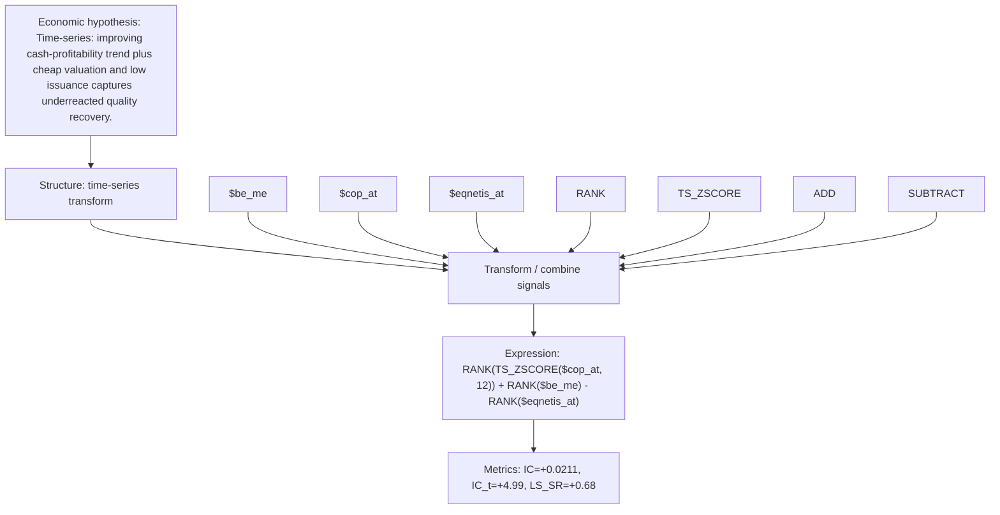

# cashprof_trend_value

- **Family:** `llm`
- **Structure:** time-series transform
- **Fields:** `$be_me, $cop_at, $eqnetis_at`
- **Operators:** `RANK, TS_ZSCORE, ADD, SUBTRACT`
- **Expression:** `RANK(TS_ZSCORE($cop_at, 12)) + RANK($be_me) - RANK($eqnetis_at)`
- **Metrics:** IC=+0.0211, IC_t=+4.99, LS_SR=+0.68