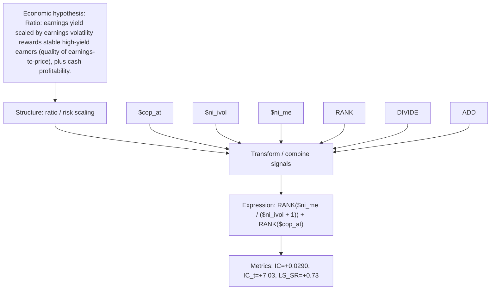

# earnings_yield_stability

- **Family:** `llm`
- **Structure:** ratio / risk scaling
- **Fields:** `$cop_at, $ni_ivol, $ni_me`
- **Operators:** `RANK, DIVIDE, ADD`
- **Expression:** `RANK($ni_me / ($ni_ivol + 1)) + RANK($cop_at)`
- **Metrics:** IC=+0.0290, IC_t=+7.03, LS_SR=+0.73