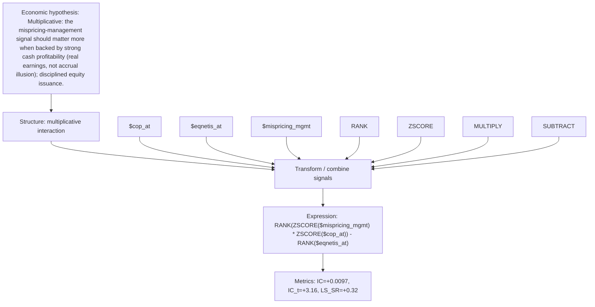

# mispr_x_cashprof

- **Family:** `llm`
- **Structure:** multiplicative interaction
- **Fields:** `$cop_at, $eqnetis_at, $mispricing_mgmt`
- **Operators:** `RANK, ZSCORE, MULTIPLY, SUBTRACT`
- **Expression:** `RANK(ZSCORE($mispricing_mgmt) * ZSCORE($cop_at)) - RANK($eqnetis_at)`
- **Metrics:** IC=+0.0097, IC_t=+3.16, LS_SR=+0.32