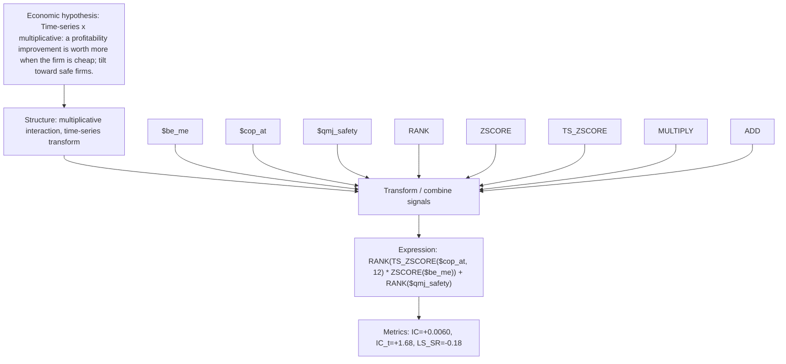

# profit_accel_x_value

- **Family:** `llm`
- **Structure:** multiplicative interaction, time-series transform
- **Fields:** `$be_me, $cop_at, $qmj_safety`
- **Operators:** `RANK, ZSCORE, TS_ZSCORE, MULTIPLY, ADD`
- **Expression:** `RANK(TS_ZSCORE($cop_at, 12) * ZSCORE($be_me)) + RANK($qmj_safety)`
- **Metrics:** IC=+0.0060, IC_t=+1.68, LS_SR=-0.18