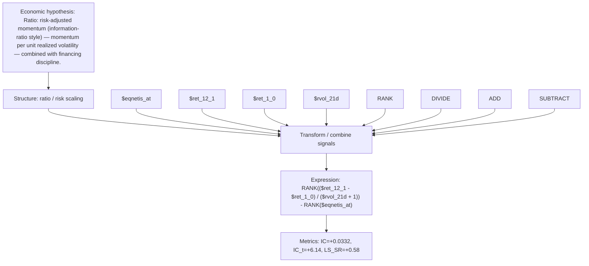

# riskadj_momentum_disc

- **Family:** `llm`
- **Structure:** ratio / risk scaling
- **Fields:** `$eqnetis_at, $ret_12_1, $ret_1_0, $rvol_21d`
- **Operators:** `RANK, DIVIDE, ADD, SUBTRACT`
- **Expression:** `RANK(($ret_12_1 - $ret_1_0) / ($rvol_21d + 1)) - RANK($eqnetis_at)`
- **Metrics:** IC=+0.0332, IC_t=+6.14, LS_SR=+0.58