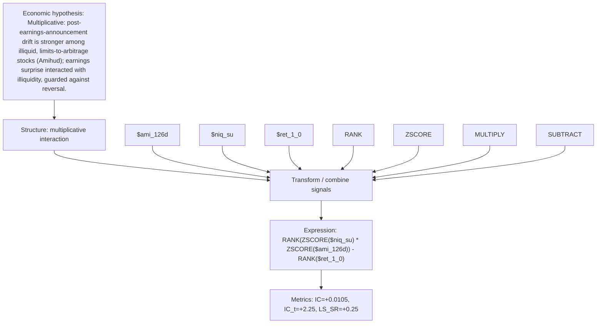

# surprise_x_illiquidity

- **Family:** `llm`
- **Structure:** multiplicative interaction
- **Fields:** `$ami_126d, $niq_su, $ret_1_0`
- **Operators:** `RANK, ZSCORE, MULTIPLY, SUBTRACT`
- **Expression:** `RANK(ZSCORE($niq_su) * ZSCORE($ami_126d)) - RANK($ret_1_0)`
- **Metrics:** IC=+0.0105, IC_t=+2.25, LS_SR=+0.25