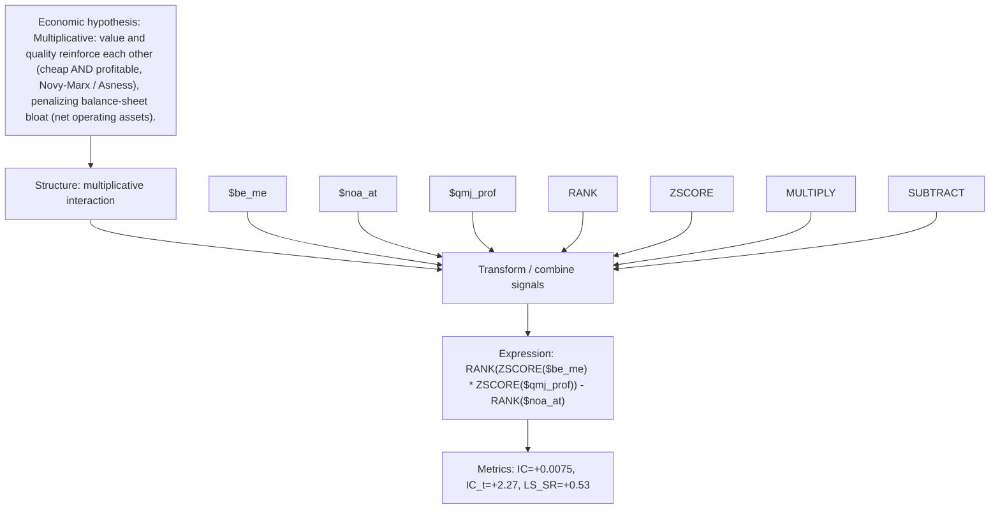

# value_x_quality

- **Family:** `llm`
- **Structure:** multiplicative interaction
- **Fields:** `$be_me, $noa_at, $qmj_prof`
- **Operators:** `RANK, ZSCORE, MULTIPLY, SUBTRACT`
- **Expression:** `RANK(ZSCORE($be_me) * ZSCORE($qmj_prof)) - RANK($noa_at)`
- **Metrics:** IC=+0.0075, IC_t=+2.27, LS_SR=+0.53