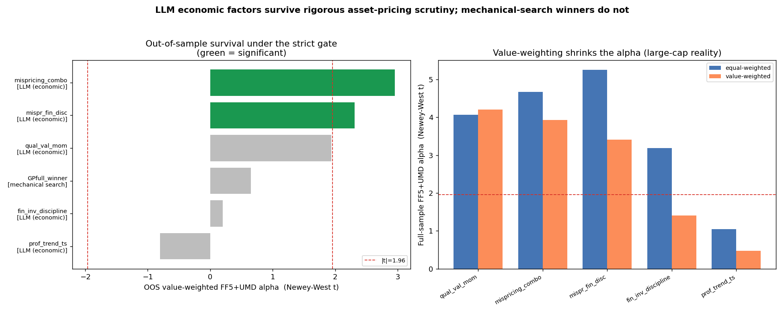

# LLM-Factor - consolidated results

[Project overview](../../../README.md) · [Reproduction guide](../../../docs/REPRODUCIBILITY.md)

> **Archived experiment.** Results below describe this stored run, not the current production of a new evaluation.

One pass. Mechanical-search baseline = full-grammar GP only; random search is excluded.

## Reading the results: full sample vs OOS

- **Full sample** = 1972-07 .. 2025 (all months). Maximum statistical power; this is the **headline result**, as in standard empirical asset-pricing papers.
- **OOS (out-of-sample)** = post-2000-12-31 only - held out, not used to pick the factors. Fewer months -> lower t, but the honest test of persistence / anti data-snooping. (Note: full sample includes OOS.)
- Because a full-sample headline has no OOS protection, the significance hurdle follows **Harvey-Liu-Zhu (2016): |t| > 3.0** (not 1.96), to suppress data-snooping.
- **OOS + walk-forward (`3_walk_forward/`) are reported as robustness**: a full-sample-strong factor that decays OOS (e.g. `qual_val_mom`) is flagged, not credited.
- The PASS verdict in `1_factor_lab/` is stricter still: VW FF5+UMD significant in **both full AND OOS**.

## Headline - full sample, value-weighted, FF5+UMD alpha

| Factor | alpha (ann) | t (NW) | HLZ t>3 | monotone | OOS t | verdict |
|---|---|---|---|---|---|---|
| qual_val_mom | +11.5% | +4.20 | PASS | +0.98 | +1.94 | FAIL |
| mispricing_combo | +8.9% | +3.93 | PASS | +0.98 | +2.96 | PASS |
| mispr_fin_disc | +7.5% | +3.41 | PASS | +0.99 | +2.31 | PASS |
| fin_inv_discipline | +3.4% | +1.41 | FAIL | +0.99 | +0.20 | FAIL |
| prof_trend_ts | +0.7% | +0.44 | FAIL | +0.32 | -0.81 | FAIL |

## Robustness - OOS value-weighted FF5+UMD alpha t

| Factor | group | OOS alpha t | verdict |
|---|---|---|---|
| qual_val_mom | LLM | +1.94 | FAIL |
| mispricing_combo | LLM | +2.96 | PASS |
| mispr_fin_disc | LLM | +2.31 | PASS |
| fin_inv_discipline | LLM | +0.20 | FAIL |
| prof_trend_ts | LLM | -0.81 | FAIL |
| GPfull_winner | GP search | +0.65 | FAIL |

## Folders

- `1_factor_lab/` - per-factor reports, `academic_table_vw.tex` (main) / `_ew.tex`, summary.csv
- `2_spanning/` - increment over components and the Kelly anomaly zoo
- `3_walk_forward/` - expanding-window 3-yr OOS blocks (stability)
- `4_multiple_testing/` - HLZ t>3, Bonferroni, Deflated Sharpe
- `5_horse_race_full/` - full-grammar GP search vs LLM; `gate/` = GP winner through the strict gate
- `6_fama_macbeth/` - firm-level Fama-MacBeth: factor slope after size/B-M/momentum/beta controls
