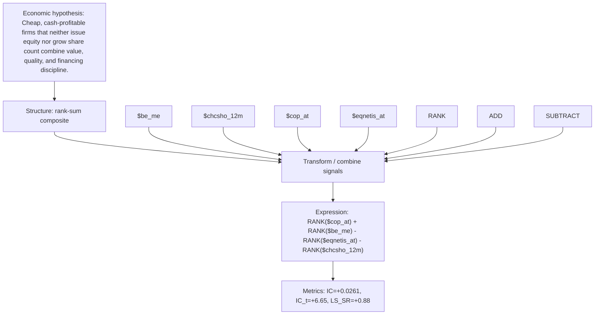

# cashprof_lowissue_value

- **Family:** ``
- **Structure:** rank-sum composite
- **Fields:** `$be_me, $chcsho_12m, $cop_at, $eqnetis_at`
- **Operators:** `RANK, ADD, SUBTRACT`
- **Expression:** `RANK($cop_at) + RANK($be_me) - RANK($eqnetis_at) - RANK($chcsho_12m)`
- **Metrics:** IC=+0.0261, IC_t=+6.65, LS_SR=+0.88