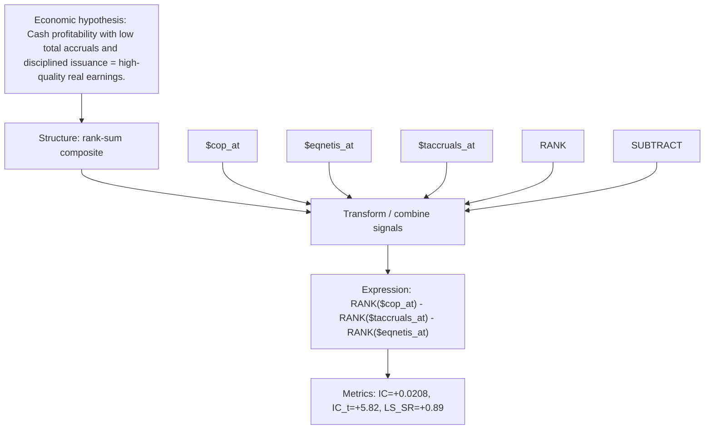

# cashprof_taccruals_disc

- **Family:** ``
- **Structure:** rank-sum composite
- **Fields:** `$cop_at, $eqnetis_at, $taccruals_at`
- **Operators:** `RANK, SUBTRACT`
- **Expression:** `RANK($cop_at) - RANK($taccruals_at) - RANK($eqnetis_at)`
- **Metrics:** IC=+0.0208, IC_t=+5.82, LS_SR=+0.89