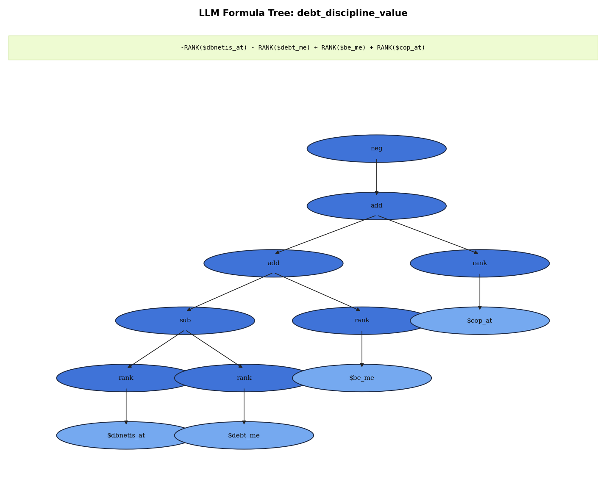

# Factor Formula — `debt_discipline_value`

[Project overview](../../../../../README.md) · [Reproduction guide](../../../../../docs/REPRODUCIBILITY.md)

A recorded expression decomposition for this factor.

[Read the expression and tree details](debt_discipline_value.md)
