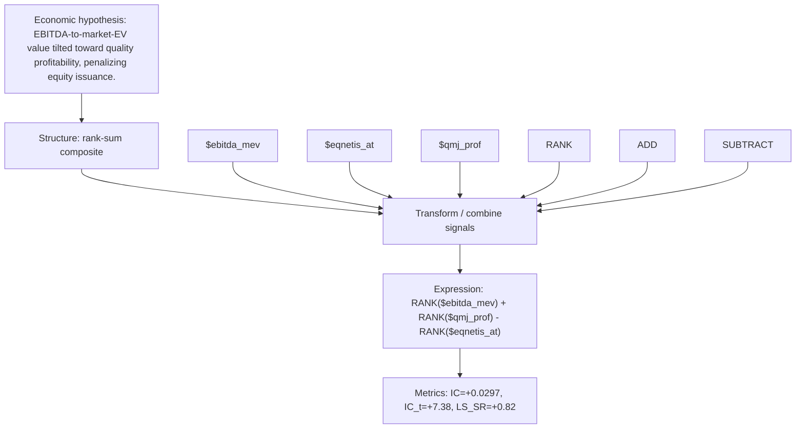

# ebitda_value_quality

- **Family:** ``
- **Structure:** rank-sum composite
- **Fields:** `$ebitda_mev, $eqnetis_at, $qmj_prof`
- **Operators:** `RANK, ADD, SUBTRACT`
- **Expression:** `RANK($ebitda_mev) + RANK($qmj_prof) - RANK($eqnetis_at)`
- **Metrics:** IC=+0.0297, IC_t=+7.38, LS_SR=+0.82