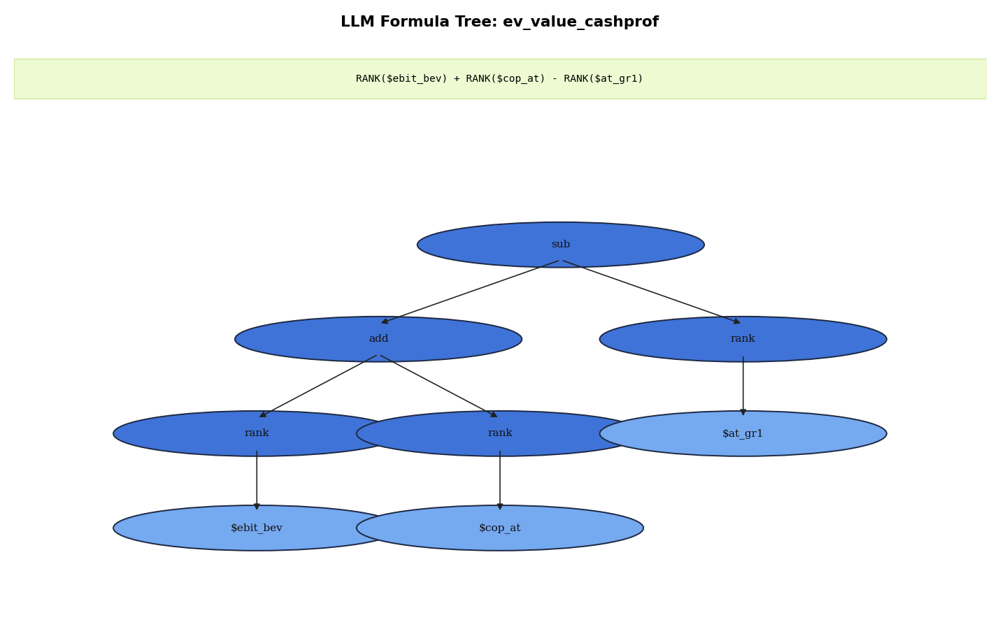

# Factor Formula — `ev_value_cashprof`

[Project overview](../../../../../README.md) · [Reproduction guide](../../../../../docs/REPRODUCIBILITY.md)

A recorded expression decomposition for this factor.

[Read the expression and tree details](ev_value_cashprof.md)
