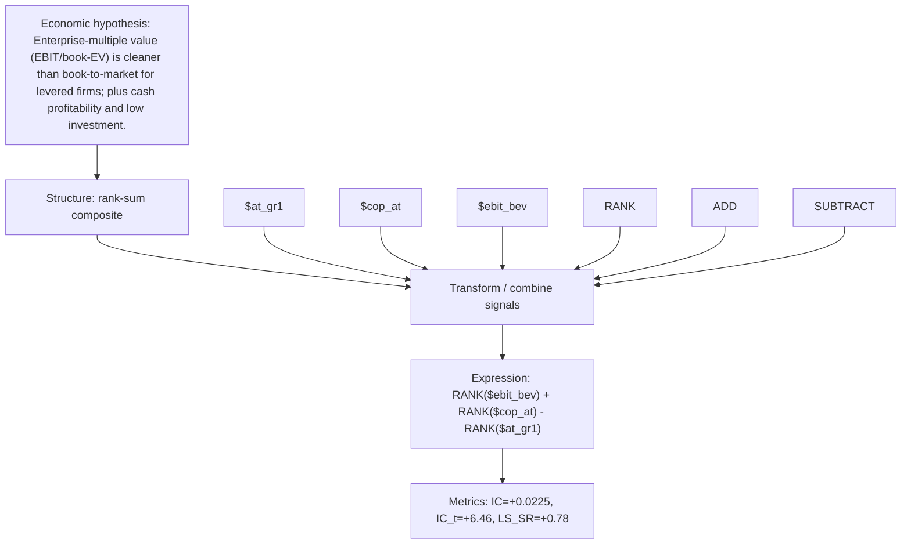

# ev_value_cashprof

- **Family:** ``
- **Structure:** rank-sum composite
- **Fields:** `$at_gr1, $cop_at, $ebit_bev`
- **Operators:** `RANK, ADD, SUBTRACT`
- **Expression:** `RANK($ebit_bev) + RANK($cop_at) - RANK($at_gr1)`
- **Metrics:** IC=+0.0225, IC_t=+6.46, LS_SR=+0.78