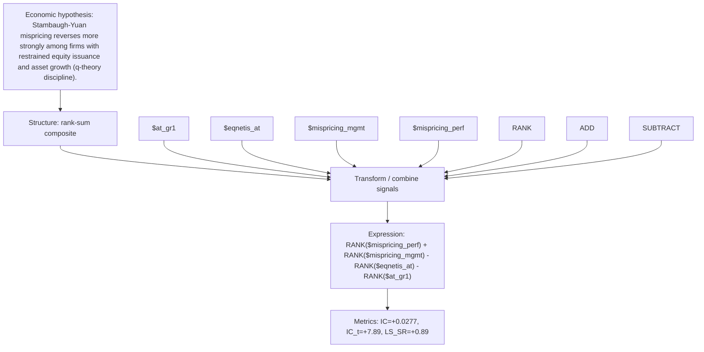

# mispr_fin_disc

- **Family:** ``
- **Structure:** rank-sum composite
- **Fields:** `$at_gr1, $eqnetis_at, $mispricing_mgmt, $mispricing_perf`
- **Operators:** `RANK, ADD, SUBTRACT`
- **Expression:** `RANK($mispricing_perf) + RANK($mispricing_mgmt) - RANK($eqnetis_at) - RANK($at_gr1)`
- **Metrics:** IC=+0.0277, IC_t=+7.89, LS_SR=+0.89