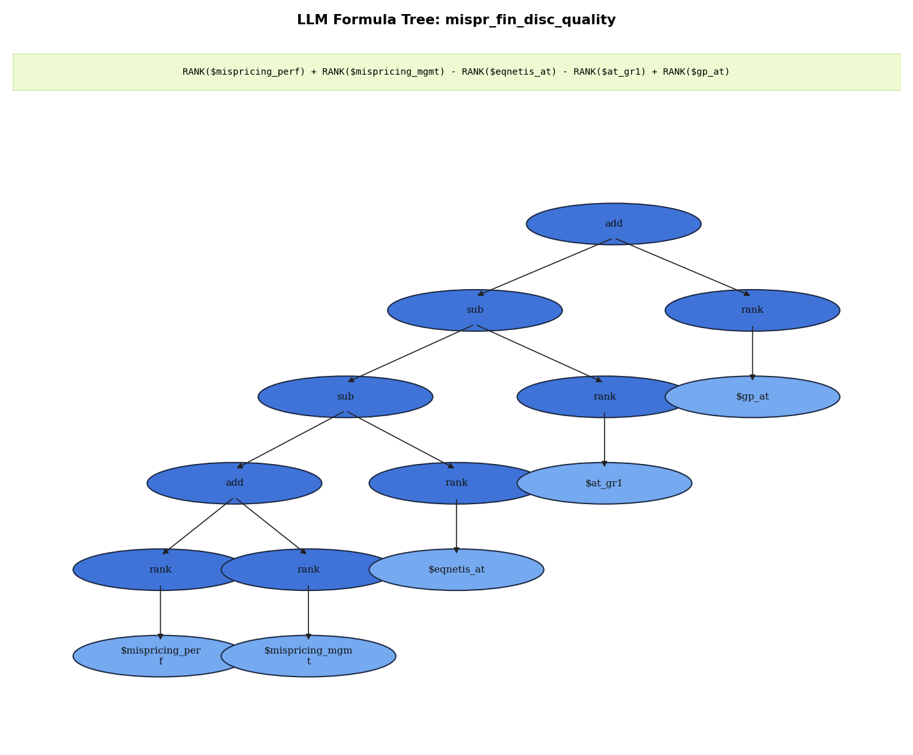

# Factor Formula — `mispr_fin_disc_quality`

[Project overview](../../../../../README.md) · [Reproduction guide](../../../../../docs/REPRODUCIBILITY.md)

A recorded expression decomposition for this factor.

[Read the expression and tree details](mispr_fin_disc_quality.md)
